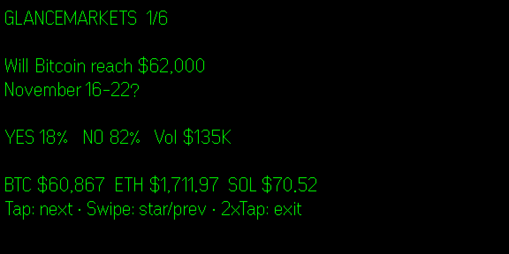

# GlanceMarkets — Prediction Markets + Crypto Prices on Even G2

GlanceMarkets puts the crypto markets you actually watch on your glasses:
the hottest crypto prediction markets from Polymarket (question, YES/NO
odds, 24h volume) plus live BTC / ETH / SOL prices from CoinGecko — one
glanceable card at a time on the Even Realities G2 display.

Built for the **Heads Up: Even Realities Hackathon** (DoraHacks),
**Crypto & DeFi track**.



**Demo video:** [`demo/glancemarkets-demo.mp4`](demo/glancemarkets-demo.mp4)
(53 seconds, recorded in the EvenHub simulator with live data)

## What it does

- Fetches the top active **crypto prediction markets** from the Polymarket
  Gamma API (tag: Crypto, ordered by 24h volume) — no API key needed.
- Fetches **BTC / ETH / SOL spot prices** from the CoinGecko public API.
- Renders one market per screen: question, YES/NO percentages, 24h volume,
  and the three spot prices along the bottom.
- **Auto-refreshes every 30 seconds**; if a fetch fails it keeps the last
  good data (with a small built-in fallback set so the first paint is
  never blank).
- Filters out near-resolved markets (YES < 1% or > 99%) so every card is a
  live, interesting market.

## Interactions (G2 touchpad)

| Gesture | Action |
|---|---|
| Tap | Next market |
| Swipe down | Star / unstar the current market (marked with `*`) |
| Swipe up | Previous market |
| Double-tap | Exit the app |

All bridge writes are serialized through a promise chain so rapid gestures
never interleave partial updates.

## Run it

```bash
npm install
npm run dev
```

Then either:

- **Simulator:** `npm run simulate`
  (or `./node_modules/@evenrealities/sim-linux-x64/bin/evenhub-simulator http://localhost:5173 --automation-port 9898` on Linux)
- **Real glasses:** `npx evenhub qr --url http://<your-ip>:5173` and scan
  with the Even Hub companion app.

## Build & pack

```bash
npm run build   # typecheck + production build into dist/
npm run pack    # build + package into an .ehpk for Even Hub distribution
```

## Project structure

| File | Purpose |
|---|---|
| `src/main.ts` | The whole app: bridge setup, data fetching, rendering, gesture handling |
| `index.html` | WebView host page (viewport locked, zoom/rubber-band disabled) |
| `app.json` | Even Hub manifest (`com.kapuyuak.glancemarkets`, no permissions) |
| `vite.config.ts` | Dev server on port 5173 with LAN binding for QR access |
| `demo/` | Demo video + simulator screenshot |

## Data sources

- **Polymarket Gamma API** — `gamma-api.polymarket.com/markets`
  (`active=true`, `tag_id=21` Crypto, ordered by `volume24hr`)
- **CoinGecko API** — `api.coingecko.com/api/v3/simple/price`
  (bitcoin, ethereum, solana in USD)

Both are public, keyless endpoints. The app requests no device permissions.

## Pre-existing work declaration

Per hackathon rules, what existed **before the build period (23 Nov 2026)**:

- The **official Even Hub starter template** (`evenhub-minimal`: Vite +
  TypeScript + Even Hub SDK + CLI + simulator, one demo text container)
  provided by Even Realities — used as the project scaffold. Its
  boilerplate (`index.html`, `vite.config.ts`, `tsconfig.json`,
  `package.json` scripts) is template code.

Everything else was created during the build period (23 Nov 2026):

- The entire GlanceMarkets application logic in `src/main.ts`
  (Polymarket + CoinGecko integration, rendering, gesture handling,
  fallback data, auto-refresh).
- The app manifest identity in `app.json` (`com.kapuyuak.glancemarkets`).
- This README, the demo video, and the screenshot in `demo/`.

No third-party code beyond the official template and the public npm
packages listed in `package.json` was used.
